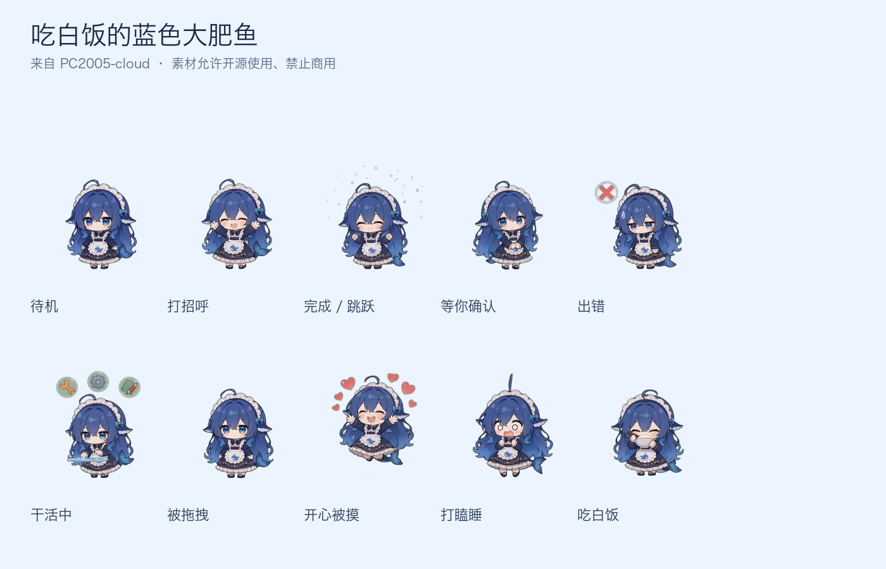

# dsh-desktop-pet

**真正住在操作系统桌面上的 DSH 桌宠**：透明、无边框、置顶、点击穿透，独立于 DSH 窗口；跟随 DSH 会话状态换动作，支持 `pet-manifest-v2` 宠物包和 `behavior.json` 行为包，并在每轮对话结束后显示本轮/本会话费用估算。

> 技术栈：**Tauri 2 + Rust + 系统 WebView**（不是 Electron；Electron 版只作为最初验证 MVP 留在 `legacy/electron/`）。
> 已在本机 macOS 26.2 (arm64) 验证：Tauri 2.12 / debug `.app` ~30MB；窗口 280×320、floating layer、置顶；sprite 加载成功（1536×3536）；hover 进入宠物时自动从点击穿透切到可交互；状态经 DSH host 插件桥实时更新。


（「吃白饭的蓝色大肥鱼」— 动画来自 [PC2005-cloud/dsh-pet](https://github.com/PC2005-cloud/dsh-pet)；本项目只做抽帧/裁切/适配，不重绘角色。）

## 功能

- **真桌宠**：透明、无边框、置顶、skipTaskbar、点击穿透；托盘显示/隐藏/退出。
- **状态桥**：DSH host 插件订阅 `session/event`，把 `thinking/tool/waiting/done/failed/idle` 写到本地 state 文件；桌宠只读这个文件，**不再每秒解压 session JSONL**（插件不在时自动回退 JSONL）。
- **行为 mod**：`pets/<id>/behavior.json` 定义动画表、阶段映射、点击/拖拽互动、挂机小动作、气泡和费用模板；非程序员也能改。
- **17 段动画**：待机/跑动/挥手/跳跃/出错/等待/干活/思考 + 拖拽/摸头/害羞/打瞌睡/吃白饭/伸懒腰/跳舞/发呆。
- **费用估算**：每轮 `turn/end` 后按 DeepSeek 峰谷价目算本轮和整段会话的 token 费用，气泡显示 `本轮 ¥x · 本会话 ¥y`。
- **随 DSH 启动**：`dsh-launcher/` host 插件拉起桌宠；DSH 退出时关掉，DSH 被强杀时桌宠自己退出。

## 快速开始

### 1. 构建

需要：Rust（[rustup](https://rustup.rs)）+ Xcode Command Line Tools + Node.js 20+。

```bash
cd dsh-desktop-pet
npm install          # @tauri-apps/cli
npm run build        # tauri build --debug --bundles app
```

> 开发时如果 Rust 装在项目内（比如为了避免污染系统），把 `RUSTUP_HOME`/`CARGO_HOME` 指到项目里的 `.toolchains/`，并把 `$CARGO_HOME/bin` 加进 `PATH` 即可。

### 2. 运行

```bash
npm run open
# 等价于：open -n "src-tauri/target/debug/bundle/macos/DSH Pet.app"
```

用 `open` 启动 `.app`，进程挂在 launchd 下，不会随启动它的终端/agent 会话退出。启动后：

- 屏幕右下角出现桌宠，悬在其他应用之上；
- 鼠标移到宠物上才可点/拖（其余区域点击穿透到下层应用）；
- 单击有回应，拖动会换拖拽动画，空闲久了会自己发呆/打瞌睡/吃白饭；
- 托盘图标可显示/隐藏/退出；调试：`npm run state`（JSONL 回退模式）或看 `pet.log`。

> 从 DSH agent 的沙箱里直接跑二进制会被 WebKit 的 sandbox 限制，所以用 `.app + open` 的方式；正常终端里也可以直接 `cargo run` 调试。

## 它怎么工作

```
DSH host 插件（dsh-launcher/）
  ├─ ctx.on('session/event')  实时 phase/tool/approval
  ├─ turn/end → sessionQuery.readSession() → 峰谷分桶 + token 费用
  ├─ 写 ~/.dsh-desktop-pet/state.json（40ms 防抖 + 10s 心跳）
  └─ 拉起 DSH Pet.app（DSH_PET_MANAGED=1）

桌宠 Rust 状态线程
  ├─ 优先读 state.json（<30s 新鲜）→ emit("pet:state")
  └─ bridge 不在 → 回退只读 session JSONL（zstd + mtime 缓存）

Tauri WebviewWindow（透明/无边框/置顶/skipTaskbar）
  └─ renderer/：behavior.json 驱动的雪碧图动画 + 气泡 + 拖拽/点击
```

关键点：

- **真桌宠**：Tauri `WindowConfig`：`transparent: true`、`decorations: false`、`alwaysOnTop: true`、`skipTaskbar: true`、`shadow: false`；系统 WebView，不打包 Chromium。
- **点击穿透**：Rust 侧 100ms 轮询全局光标 + 窗口位置，命中宠物矩形才 `set_ignore_cursor_events(false)`，移出恢复 `true`。
- **状态源（P1）**：DSH host 插件桥；`state.json` 和桌宠同一台机器，零网络、零端口。插件被禁用/卸载时自动回退 JSONL，不影响独立使用。
- **宠物包**：`pet-manifest-v2` 的 `sprite2d` 子集；Rust 读 `pet.json` + `behavior.json` + `spritesheet`，把图集转 data URL 给前端。

## 费用估算

每轮 `turn/end` 时，host 插件通过 `sessionQuery.readSession()` 折叠整段会话日志：

- 按每条 `assistant/message` 的 `usage` 累计 `inputTokens / outputTokens / cacheReadTokens / cacheWriteTokens`；
- 按事件发生时刻判断 **高峰/空闲** 时段（北京时间 周一至周五 09:00–12:00、14:00–18:00；法定节假日除外；空闲价 = 高峰价 × 50%）；
- 按模型单价换算人民币，气泡显示 `本轮 ¥x · 本会话 ¥y`；失败轮也会显示。

默认价目（元 / 百万 tokens，高峰价；`deepseek-flash`）：

| 缓存命中输入 | 缓存未命中输入 | 输出 |
| --- | --- | --- |
| 0.04 | 2 | 8 |

覆盖方式：在 `~/.dsh-desktop-pet/pricing.json` 写自定义表（高峰价，空闲自动减半）：

```json
{
  "deepseek-flash": { "cacheRead": 0.04, "input": 2, "output": 8 },
  "deepseek-v4-pro": { "cacheRead": 0.3, "input": 9, "output": 27 }
}
```

> 这是**估算**，不是官方账单；未配置的模型回退到 `*` 价目，子代理是独立会话、不计入当前会话合计。实际扣费以官方用量页为准。

## 行为 mod（L1）

宠物包可以带一个 `behavior.json`（见 [`docs/BEHAVIOR.md`](docs/BEHAVIOR.md)）：

```json
{
  "animations": {
    "idle": { "row": 0, "frames": 8, "durations": [375], "loop": true },
    "drag": { "row": 9, "frames": 6, "durations": [333] }
  },
  "phases": {
    "idle": { "animation": "idle" },
    "done": { "sequence": ["jump", "wave", "idle"] }
  },
  "bubbles": { "done": ["搞定！", "收工～"] },
  "interactions": {
    "click": { "animations": ["wave", "pet", "shy"], "bubbles": ["在呢在呢"] },
    "drag": { "animation": "drag", "bubble": "放我下来～" },
    "idleActions": [
      { "afterMs": 240000, "animation": "sleep", "bubble": "Zzz…", "once": true }
    ]
  },
  "cost": { "enabled": true, "template": "本轮 {lastAmount} · 本会话 {sessionAmount}", "delayMs": 700, "ttlMs": 9000 }
}
```

没有 `behavior.json` 的旧 pet pack 会使用 renderer 内置默认行为；行为文件只描述数据，不需要写 JS。

## 状态映射

| phase | 触发（host 插件事件 / JSONL 回退） | 默认动画 |
|---|---|---|
| `thinking` | `turn/start` / `step/start` / `tool/result` 之后 | `think` |
| `tool` | `tool/call`（shell/edit/web/read/agent/mcp） | `work` |
| `waiting` | `ask_user_question`、`approval/asked` | `wait` |
| `done` | `turn/end completed`（8s 后回落 idle） | `jump → wave → idle` |
| `failed` | `turn/end` 的 error/blocked 等（15s 后回落） | `sad → wait → idle` |
| `idle` | 无活动 / 终态超时 | `idle` + 挂机小动作 |

多会话按 `failed > waiting > tool > thinking > review > done > idle` 聚合。

## 宠物包（L0 mod）

搜索顺序（同 id 后者覆盖前者）：

1. `dsh-desktop-pet/pets/<id>/pet.json`
2. `$DSH_HOME/pets/<id>/pet.json`（与 DSH 桌宠生态共用）
3. `~/.dsh-desktop-pet/pets/<id>/pet.json`

字段（sprite2d 子集）：`id`、`displayName`、`license`、`renderer:"sprite2d"`、`behaviorPath`、`sprite2d.spritesheetPath`、`cell`、`columns`、`atlasRows`、`frames`、`tracks.durations`、`sequences`。示例见 [`pets/dafeiyu/pet.json`](pets/dafeiyu/pet.json)；素材来自 [PC2005-cloud/dsh-pet](https://github.com/PC2005-cloud/dsh-pet)（素材允许开源使用、禁止商用），见 [`THIRD_PARTY_NOTICES.md`](THIRD_PARTY_NOTICES.md)。

默认包行约定（17 行，8 列）：

```
0 idle | 1 walk-right | 2 walk-left | 3 wave | 4 jump | 5 sad | 6 wait | 7 work | 8 think
9 drag | 10 pet | 11 shy | 12 sleep | 13 eat | 14 stretch | 15 dance | 16 daydream
```

## 随 DSH 启动

`dsh-launcher/` 是 DSH host 插件，同时负责「启动桌宠」+「状态/费用桥」。安装（DSH 桌面端不允许外部 CLI 改 profile，需要走插件页）：

1. DSH 左侧栏 → **插件** → 右上 **添加插件** → **本地目录**
2. 填 `/Users/wqian/Dev/dsh-desktop-pet/dsh-launcher`（或你 clone 后的绝对路径）
3. 安装后点 **立即启用**
4. **完全退出 DSH 再打开**（插件层重启才组装）

之后再打开 DSH，桌宠会自己出现；不需要手动 `npm run open`。细节见 [`dsh-launcher/README.md`](dsh-launcher/README.md)。

## 美术与许可

默认宠物「吃白饭的蓝色大肥鱼」的动画来自 **[PC2005-cloud/dsh-pet](https://github.com/PC2005-cloud/dsh-pet)**，本项目**不重绘角色**：`tools/make-dafeiyu-pet.py` 从其透明 VP9 WebM 动画里抽帧，用固定裁切窗拼成 1536×3536 图集（`pets/dafeiyu/`）。原始 16 段 WebM 存在 `tools/art-src/dafeiyu/`，方便复现。

上游许可：**代码 MIT**；**素材（动画/提示词/源视频）允许开源使用、禁止商用**（上游 README）。所以这个宠物包按「非官方、非商用 fan art」处理。

**其他人复用本宠物包/素材的要求**：禁止商用（收费、付费分发、广告变现等，商用需联系上游作者）；再分发/修改时保留 `pets/dafeiyu/NOTICE.md`、`LICENSE` 和根目录 `THIRD_PARTY_NOTICES.md`；本仓库代码自身是 MIT，但不会因此解除素材的非商用限制。个人桌面使用没问题。

## 目录

```
src-tauri/          Rust 后端（窗口/托盘/hover 穿透/桥状态读取/JSONL 回退/pack 加载）
renderer/           前端（behavior.json 驱动的雪碧图动画/气泡/交互）
pets/dafeiyu/       默认宠物包（17 行动画图集 + pet.json + behavior.json）
dsh-launcher/       DSH host 插件（启动器 + 状态/费用桥）
tools/              抽帧/图集生成、预览图、状态调试 CLI
docs/BEHAVIOR.md    行为包 schema
legacy/electron/    最初验证 MVP 的 Electron 版（仅对照）
```

## Roadmap

- [x] Tauri 2 透明置顶窗 + 点击穿透 + 拖拽/托盘 + 雪碧图
- [x] DSH host 插件桥（`session/event` → state.json；JSONL 回退）
- [x] L1 行为包 `behavior.json`（动画/阶段/互动/挂机/气泡）
- [x] 17 段动画 + 每轮/每会话费用估算（峰谷价）
- [ ] P2：frames2d / Live2D 渲染；多角色/多实例；release 签名分发；Windows/Linux 适配

## 已知限制

- debug 构建 `.app` ~30MB；release 会更小但还没打（`npm run build:release`）。
- 费用是估算：未配置模型回退 `*` 价目；子代理独立计费、不计入当前会话；以官方用量页为准。
- 桥插件被禁用时回退 JSONL，约 1s 延迟，且看不到未落盘的审批 UI 状态。
- 目前只在 macOS 验证；Windows/Linux 的透明窗/置顶/点击穿透需要各自适配。
- 仅支持 sprite2d 宠物包；Live2D/frames2d 未接。
