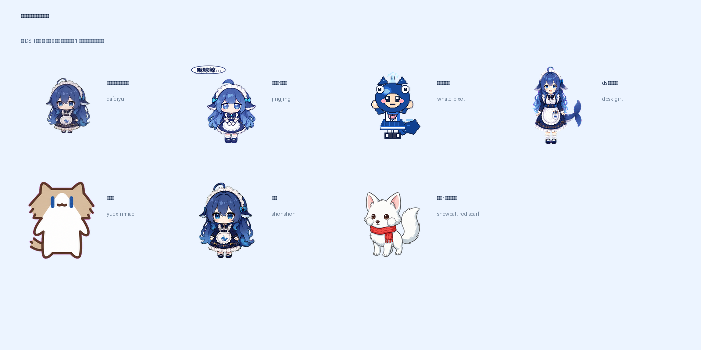

# dsh-desktop-pet

**真正住在操作系统桌面上的 DSH 桌宠**：透明、无边框、置顶、点击穿透，独立于 DSH 窗口；跟随 DSH 会话状态换动作，支持 `pet-manifest-v2` 宠物包和 `behavior.json` 行为包，并在每轮对话结束后显示本轮/本会话费用估算。

> 技术栈：**Tauri 2 + Rust + 系统 WebView**（不是 Electron；Electron 版只作为最初验证 MVP 留在 `legacy/electron/`）。
> 已在本机 macOS 26.2 (arm64) 验证：Tauri 2.12 / debug `.app` ~30MB；窗口 280×320、floating layer、置顶；sprite 加载成功（1536×3536）；hover 进入宠物时自动从点击穿透切到可交互；状态经 DSH host 插件桥实时更新。


（默认形象「吃白饭的蓝色大肥鱼」来自 PC2005-cloud/dsh-pet；其余社区形象及许可见 [`THIRD_PARTY_NOTICES.md`](THIRD_PARTY_NOTICES.md)。本项目只做图集/行为适配，不重绘角色。）

## 功能

- **真桌宠**：透明、无边框、置顶、skipTaskbar、点击穿透；托盘显示/隐藏/退出。
- **状态桥**：DSH host 插件订阅 `session/event`，把 `thinking/tool/waiting/done/failed/idle` 写到本地 state 文件；桌宠只读这个文件，**不再每秒解压 session JSONL**（插件不在时自动回退 JSONL）。
- **行为 mod**：`pets/<id>/behavior.json` 定义动画表、阶段映射、点击/拖拽互动、挂机小动作、气泡和费用模板；非程序员也能改。
- **更换形象（热加载）**：DSH 设置 → 桌宠 → 形象，或右键 → 更换形象；选中后约 1 秒切换，不重启 DSH/桌宠。新增 pack 目录后点「刷新」即可。
- **会话状态面板**：桌宠头顶最多 7 个会话，绿=完成、黄=等你回答、红=失败、蓝=运行中；完成提醒保留到手动清掉，可折叠/隐藏。
- **桌面互动（v0.3）**：`Option+Shift+P` 标记当前鼠标位置，桌宠跑过去；DSH 空闲时自动在桌面散步。
- **休闲功能开关**：DSH 设置 → 桌宠 → 休闲功能，可分别关闭自动散步、挂机小动作、快捷键召唤（右键设置里也有）。
- **点击会话跳转**：点桌宠状态面板里的某条会话，DSH 会自动激活并打开对应会话。
- **17 段动画**：待机/跑动/挥手/跳跃/出错/等待/干活/思考 + 拖拽/摸头/害羞/打瞌睡/吃白饭/伸懒腰/跳舞/发呆。
- **费用估算**：每轮 `turn/end` 后按 DeepSeek 峰谷价目算本轮和整段会话的 token 费用，气泡显示 `本轮 ¥x · 本会话 ¥y`。
- **余额与高优会话**：host 插件读取 DSH 账户余额；右键/托盘菜单显示余额和「等待确认 / 出错」的高优会话列表，也可以选择不显示。
- **设置菜单**：右键桌宠或托盘 → **设置**，可以分别开关余额、高优会话、费用气泡、Dock 图标、菜单栏图标和随 DSH 启动。
- **随 DSH 启动（默认开）**：`dsh-launcher/` host 插件负责拉起/关闭桌宠；托盘/右键菜单可关。

## 自带形象

| id | 名称 | 来源/许可 |
|---|---|---|
| `dafeiyu`（默认） | 吃白饭的蓝色大肥鱼 | PC2005-cloud/dsh-pet（素材开源可用、禁商用） |
| `jingjing` | 大肥鱼·鲸鲸娘 | zhouwu97/ds-pet（MIT） |
| `whale-pixel` | 鲸鱼娘·像素 | chenthreegold/deepseek-whale-pet（MIT） |
| `dpsk-girl` | ds 鲸鱼女仆 | LINNoot/dsh-co-pet（MIT） |
| `yuexinmiao` | 月薪喵 | LINNoot/dsh-co-pet（MIT） |
| `shenshen` | 深深 | schrieeeffer/shenshen-codex-pet（视觉 CC BY-NC-SA 4.0） |
| `snowball-red-scarf` | 雪团 · 红围巾白狐 | 原创 AI 辅助（MIT；见包内 NOTICE，模型生成素材权利有不确定性） |

在 **DSH 设置 → 桌宠 → 形象** 里选，或右键桌宠 → **更换形象**。约 1 秒热切换，不重启。

## 自己做一个

- 规范：[`docs/PET_PACK_SPEC.md`](docs/PET_PACK_SPEC.md)
- Agent skill（可直接给 Codex / DSH / Claude 等 agent 读）：[`skills/create-dsh-pet/SKILL.md`](skills/create-dsh-pet/SKILL.md)
- 工具：`python3 tools/import-codex-pet.py --help`、`python3 tools/validate-pet-pack.py --all`
- 仓库根 [`AGENTS.md`](AGENTS.md) 是给 coding agent 的入口。

一句话流程：生成/收集 **8 列 × 至少 9 行、192×208/格、透明背景**图集 → `import-codex-pet.py` 生成清单 → 补 LICENSE/NOTICE → `validate-pet-pack.py` 校验 → 复制到 `~/.dsh-desktop-pet/pets/` → DSH 设置里刷新选中。

## 快速开始

### 1. 构建

需要：Rust（[rustup](https://rustup.rs)）+ Xcode Command Line Tools + Node.js 20+。

```bash
cd dsh-desktop-pet
npm install          # @tauri-apps/cli
npm run build        # tauri build --debug --bundles app
```

> 开发时如果 Rust 装在项目内（比如为了避免污染系统），把 `RUSTUP_HOME`/`CARGO_HOME` 指到项目里的 `.toolchains/`，并把 `$CARGO_HOME/bin` 加进 `PATH` 即可。

### 2. 运行

```bash
npm run open
# 等价于：open -n "src-tauri/target/debug/bundle/macos/DSH Pet.app"
```

用 `open` 启动 `.app`，进程挂在 launchd 下，不会随启动它的终端/agent 会话退出。启动后：

- 屏幕右下角出现桌宠，悬在其他应用之上；
- 鼠标移到宠物上才可点/拖（其余区域点击穿透到下层应用）；
- 单击有回应，拖动会换拖拽动画，空闲久了会自己发呆/打瞌睡/吃白饭；
- 托盘图标可显示/隐藏/退出；调试：`npm run state`（JSONL 回退模式）或看 `pet.log`。

> 从 DSH agent 的沙箱里直接跑二进制会被 WebKit 的 sandbox 限制，所以用 `.app + open` 的方式；正常终端里也可以直接 `cargo run` 调试。

## 测试 / 给别人用

- 自动化：`bash scripts/smoke-test.sh`（`--app` 会临时 HOME 启动一次桌宠）
- CI：`.github/workflows/ci.yml`（packs + JS + cargo check）
- 完整干净环境/beta 清单：[`docs/TESTING.md`](docs/TESTING.md)
- 排障信息采集：`bash scripts/doctor.sh`

**v0.3.2 已提供 macOS arm64 分发包**（含 `.app`、7 个宠物包、DSH 插件和安装说明）。因为还没有 Apple Developer ID 签名/公证，首次打开需要右键 `.app` → 打开；安装参见 [`docs/INSTALL.md`](docs/INSTALL.md)。从源码构建仍然是开发方式。

## 它怎么工作

```
DSH host 插件（dsh-launcher/）
  ├─ ctx.on('session/event')  实时 phase/tool/approval
  ├─ turn/end → sessionQuery.readSession() → 峰谷分桶 + token 费用
  ├─ 写 ~/.dsh-desktop-pet/state.json（40ms 防抖 + 10s 心跳）
  └─ 拉起 DSH Pet.app（DSH_PET_MANAGED=1）

桌宠 Rust 状态线程
  ├─ 优先读 state.json（<30s 新鲜）→ emit("pet:state")
  └─ bridge 不在 → 回退只读 session JSONL（zstd + mtime 缓存）

Tauri WebviewWindow（透明/无边框/置顶/skipTaskbar）
  └─ renderer/：behavior.json 驱动的雪碧图动画 + 气泡 + 拖拽/点击
```

关键点：

- **真桌宠**：Tauri `WindowConfig`：`transparent: true`、`decorations: false`、`alwaysOnTop: true`、`skipTaskbar: true`、`shadow: false`；系统 WebView，不打包 Chromium。
- **点击穿透**：Rust 侧 100ms 轮询全局光标 + 窗口位置，命中宠物矩形才 `set_ignore_cursor_events(false)`，移出恢复 `true`。
- **状态源（P1）**：DSH host 插件桥；`state.json` 和桌宠同一台机器，零网络、零端口。插件被禁用/卸载时自动回退 JSONL，不影响独立使用。
- **宠物包**：`pet-manifest-v2` 的 `sprite2d` 子集；Rust 读 `pet.json` + `behavior.json` + `spritesheet`，把图集转 data URL 给前端。

## 费用估算

每轮 `turn/end` 时，host 插件通过 `sessionQuery.readSession()` 折叠整段会话日志：

- 按每条 `assistant/message` 的 `usage` 累计 `inputTokens / outputTokens / cacheReadTokens / cacheWriteTokens`；
- 按事件发生时刻判断 **高峰/空闲** 时段（北京时间 周一至周五 09:00–12:00、14:00–18:00；法定节假日除外；空闲价 = 高峰价 × 50%）；
- 按模型单价换算人民币，气泡显示 `本轮 ¥x · 本会话 ¥y`；失败轮也会显示。

默认价目（元 / 百万 tokens，高峰价；`deepseek-flash`）：

| 缓存命中输入 | 缓存未命中输入 | 输出 |
| --- | --- | --- |
| 0.04 | 2 | 8 |

覆盖方式：在 `~/.dsh-desktop-pet/pricing.json` 写自定义表（高峰价，空闲自动减半）：

```json
{
  "deepseek-flash": { "cacheRead": 0.04, "input": 2, "output": 8 },
  "deepseek-v4-pro": { "cacheRead": 0.3, "input": 9, "output": 27 }
}
```

> 这是**估算**，不是官方账单；未配置的模型回退到 `*` 价目，子代理是独立会话、不计入当前会话合计。实际扣费以官方用量页为准。

## 行为 mod（L1）

宠物包可以带一个 `behavior.json`（见 [`docs/BEHAVIOR.md`](docs/BEHAVIOR.md)）：

```json
{
  "animations": {
    "idle": { "row": 0, "frames": 8, "durations": [375], "loop": true },
    "drag": { "row": 9, "frames": 6, "durations": [333] }
  },
  "phases": {
    "idle": { "animation": "idle" },
    "done": { "sequence": ["jump", "wave", "idle"] }
  },
  "bubbles": { "done": ["搞定！", "收工～"] },
  "interactions": {
    "click": { "animations": ["wave", "pet", "shy"], "bubbles": ["在呢在呢"] },
    "drag": { "animation": "drag", "bubble": "放我下来～" },
    "idleActions": [
      { "afterMs": 240000, "animation": "sleep", "bubble": "Zzz…", "once": true }
    ]
  },
  "cost": { "enabled": true, "template": "本轮 {lastAmount} · 本会话 {sessionAmount}", "delayMs": 700, "ttlMs": 9000 }
}
```

没有 `behavior.json` 的旧 pet pack 会使用 renderer 内置默认行为；行为文件只描述数据，不需要写 JS。

## 状态映射

| phase | 触发（host 插件事件 / JSONL 回退） | 默认动画 |
|---|---|---|
| `thinking` | `turn/start` / `step/start` / `tool/result` 之后 | `think` |
| `tool` | `tool/call`（shell/edit/web/read/agent/mcp） | `work` |
| `waiting` | `ask_user_question`、`approval/asked` | `wait` |
| `done` | `turn/end completed`（8s 后回落 idle） | `jump → wave → idle` |
| `failed` | `turn/end` 的 error/blocked 等（15s 后回落） | `sad → wait → idle` |
| `idle` | 无活动 / 终态超时 | `idle` + 挂机小动作 |

多会话按 `failed > waiting > tool > thinking > review > done > idle` 聚合。

## 宠物包（L0 mod）

搜索顺序（同 id 后者覆盖前者）：

1. `dsh-desktop-pet/pets/<id>/pet.json`
2. `$DSH_HOME/pets/<id>/pet.json`（与 DSH 桌宠生态共用）
3. `~/.dsh-desktop-pet/pets/<id>/pet.json`

字段（sprite2d 子集）：`id`、`displayName`、`license`、`renderer:"sprite2d"`、`behaviorPath`、`sprite2d.spritesheetPath`、`cell`、`columns`、`atlasRows`、`frames`、`tracks.durations`、`sequences`。示例见 [`pets/dafeiyu/pet.json`](pets/dafeiyu/pet.json)；素材来自 [PC2005-cloud/dsh-pet](https://github.com/PC2005-cloud/dsh-pet)（素材允许开源使用、禁止商用），见 [`THIRD_PARTY_NOTICES.md`](THIRD_PARTY_NOTICES.md)。

默认包行约定（17 行，8 列）：

```
0 idle | 1 walk-right | 2 walk-left | 3 wave | 4 jump | 5 sad | 6 wait | 7 work | 8 think
9 drag | 10 pet | 11 shy | 12 sleep | 13 eat | 14 stretch | 15 dance | 16 daydream
```

## 更换桌宠形象（热加载）

**DSH 设置 → 桌宠 → 形象** 选择宠物包；保存后桌宠热切换，约 1 秒生效，不需要重启。右键桌宠 → **更换形象** 也可以快速切。

- 可用 pack 搜索顺序：项目 `pets/` → `$DSH_HOME/pets/` → `~/.dsh-desktop-pet/pets/`
- 把新的 pet pack 目录（含 `pet.json`、图集、可选 `behavior.json`）放进以上任一目录，点设置页的 **刷新** 就能看到
- 切换后会立即重载图集/行为；**手工编辑当前 pack 的 `pet.json` / 图集 / `behavior.json` 也会在 1 秒内热重载**
- 选中的 pack 被删除/改名时，自动回落到配置里的上一个有效 pack
- 当前 pack id 存在 `~/.dsh-desktop-pet/settings.json` 的 `packId`，同时同步到项目 `.userdata/config.json`

## 设置与自定义显示

**DSH 设置页 → 桌宠**（推荐；首次更新后重启 DSH 出现）可以配置全部显示项和自定义图标，保存后桌宠 1s 内生效。右键桌宠 / 托盘的 **设置** 菜单保留作为快速入口，功能相同。

| 开关 | 默认 | 作用 |
|---|---|---|
| 随 DSH 启动 | ✅ | 下次 DSH 启动自动拉起桌宠 |
| 显示余额 | ✅ | 气泡/菜单显示 DSH 账户余额 |
| 显示高优会话 | ✅ | 菜单列出 waiting/failed 会话，气泡显示高优数量 |
| 显示费用气泡 | ✅ | 每轮结束显示本轮/本会话费用 |
| 显示 Dock 图标 | ❌ | 程序坞图标 |
| 显示菜单栏图标 | ❌ | 右上角托盘图标；隐藏后右键桌宠仍可控制 |

| 自定义图标 | - | 选择本地 Dock/菜单栏 PNG，或恢复默认图标 |

全部持久化到 `~/.dsh-desktop-pet/settings.json`：

```json
{
  "autoStart": true,
  "showDockIcon": false,
  "showTrayIcon": false,
  "showBalance": true,
  "showPrioritySessions": true,
  "showCost": true
}
```

余额由 `dsh-launcher` host 插件通过 DSH 的 `deepseekAccount.getBalance()` 获取，启动后 1.2s 拉一次、之后每 60s / 每轮结束刷新；不会把账户密钥写到本地。余额/高优会话也可以只在右键菜单看，气泡里不想显示就关掉对应开关。

## 随 DSH 启动（默认开启）

`dsh-launcher/` 是 DSH host 插件：**默认随 DSH 启动桌宠**（`autoStart` 默认 `true`）。开关方式：

- 显示图标后，托盘菜单里勾选/取消 **随 DSH 启动（下次启动生效）**
- 图标都隐藏时，**右键桌宠** → 勾选/取消 **随 DSH 启动**

设置写在 `~/.dsh-desktop-pet/settings.json`：

```json
{ "autoStart": true }
```

DSH 启动时插件会自动拉起桌宠；DSH 退出时关掉，DSH 被强杀时桌宠自己退出。DSH 插件页安装步骤见 [`dsh-launcher/README.md`](dsh-launcher/README.md)。

## 自定义图标

**默认不显示 Dock 图标和菜单栏图标**（`showDockIcon=false`、`showTrayIcon=false`），只留桌面上的桌宠窗口；**右键桌宠**可以打开「显示图标」「设置」「自定义图标」等菜单。

### 在设置里换图标

**DSH 设置页 → 桌宠 → 图标**，或右键桌宠 → **设置 → 自定义图标**：

- **选择 Dock 图标…**：弹出文件选择器，选一张 PNG，自动复制到 `~/.dsh-desktop-pet/icons/app.png`
- **选择菜单栏图标…**：同上，复制到 `~/.dsh-desktop-pet/icons/tray.png`
- **打开图标目录…**：直接打开 `~/.dsh-desktop-pet/icons/`
- **重载自定义图标**：手动替换文件后点这个立即生效
- **恢复默认图标**：清掉自定义图标，回到项目内我们自己画的那套

也可以不走菜单，直接把 PNG 放到：

```
~/.dsh-desktop-pet/icons/app.png     # Dock 图标，建议 512×512 / 1024×1024
~/.dsh-desktop-pet/icons/tray.png    # 菜单栏图标，建议 22×22 / 44×44（黑+透明 template 风格）
```

或者在宠物包里放：`pets/<id>/icon.png`、`pets/<id>/tray.png`（优先级低于用户目录）。然后在托盘菜单点 **重载自定义图标** 立即生效；重启也会自动加载。

也可以用 `~/.dsh-desktop-pet/settings.json` 的 `icons.app` / `icons.tray` 显式指定路径（相对 `~/.dsh-desktop-pet/` 或绝对路径）：

```json
{
  "autoStart": true,
  "showDockIcon": true,
  "showTrayIcon": true,
  "showBalance": true,
  "showPrioritySessions": true,
  "showCost": true,
  "icons": { "app": "icons/my-icon.png", "tray": "icons/my-tray.png" }
}
```

显示/隐藏图标在托盘菜单里分别有 **显示 Dock 图标**、**显示菜单栏图标** 两个开关；两个都隐藏后，用右键桌宠菜单恢复。如果右键菜单因为权限/坐标问题打不开，直接编辑 `~/.dsh-desktop-pet/settings.json`：

```json
{ "showDockIcon": true, "showTrayIcon": true }
```

然后重启桌宠，就能重新看到图标。

说明：Dock 图标是运行时替换；Finder/启动台里的 `.app` bundle 图标仍是打包时那张，要改 bundle 图标需要重新 `tauri icon` + 打包。托盘菜单还有 **打开图标目录…** 直接打开 `~/.dsh-desktop-pet/icons/`。

## 美术与许可

默认宠物「吃白饭的蓝色大肥鱼」的动画来自 **[PC2005-cloud/dsh-pet](https://github.com/PC2005-cloud/dsh-pet)**，本项目**不重绘角色**：`tools/make-dafeiyu-pet.py` 从其透明 VP9 WebM 动画里抽帧，用固定裁切窗拼成 1536×3536 图集（`pets/dafeiyu/`）。原始 16 段 WebM 存在 `tools/art-src/dafeiyu/`，方便复现。

上游许可：**代码 MIT**；**素材（动画/提示词/源视频）允许开源使用、禁止商用**（上游 README）。所以这个宠物包按「非官方、非商用 fan art」处理。

**其他人复用本宠物包/素材的要求**：禁止商用（收费、付费分发、广告变现等，商用需联系上游作者）；再分发/修改时保留 `pets/dafeiyu/NOTICE.md`、`LICENSE` 和根目录 `THIRD_PARTY_NOTICES.md`；本仓库代码自身是 MIT，但不会因此解除素材的非商用限制。个人桌面使用没问题。

## 目录

```
src-tauri/          Rust 后端（窗口/托盘/hover 穿透/桥状态读取/JSONL 回退/pack 加载）
renderer/           前端（behavior.json 驱动的雪碧图动画/气泡/交互）
pets/dafeiyu/       默认宠物包（17 行动画图集 + pet.json + behavior.json）
dsh-launcher/       DSH host 插件（启动器 + 状态/费用桥）
tools/              抽帧/图集生成、预览图、状态调试 CLI
docs/PET_PACK_SPEC.md  宠物包规范（给人类/agent）
docs/BEHAVIOR.md       行为包 schema
skills/create-dsh-pet/ Agent Skill：生成/修改桌宠
AGENTS.md              Agent 入口
tools/import-codex-pet.py  从 Codex 图集导入
tools/validate-pet-pack.py 宠物包校验
legacy/electron/    最初验证 MVP 的 Electron 版（仅对照）
```

## Roadmap

- [x] Tauri 2 透明置顶窗 + 点击穿透 + 拖拽/托盘 + 雪碧图
- [x] DSH host 插件桥（`session/event` → state.json；JSONL 回退）
- [x] L1 行为包 `behavior.json`（动画/阶段/互动/挂机/气泡）
- [x] 17 段动画 + 每轮/每会话费用估算（峰谷价）
- [ ] P2：frames2d / Live2D 渲染；多角色/多实例；release 签名分发；Windows/Linux 适配

## 已知限制

- debug 构建 `.app` ~30MB；release 会更小但还没打（`npm run build:release`）。
- 费用是估算：未配置模型回退 `*` 价目；子代理独立计费、不计入当前会话；以官方用量页为准。
- 桥插件被禁用时回退 JSONL，约 1s 延迟，且看不到未落盘的审批 UI 状态。
- 目前只在 macOS 验证；Windows/Linux 的透明窗/置顶/点击穿透需要各自适配。
- 仅支持 sprite2d 宠物包；Live2D/frames2d 未接。
